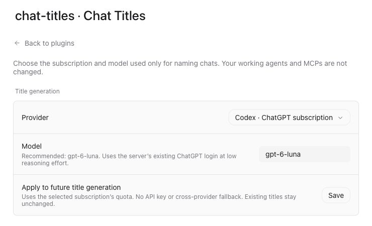

# Paseo Chat Titles

Automatic chat titles for [Paseo](https://paseo.sh), using your existing Codex or Claude CLI login and a configurable model. Changes chat metadata, not working-agent prompts, MCPs or permissions.



## Install

On the machine running your Paseo daemon:

```sh
paseo plugin add git:iarmankhan/paseo-chat-titles --ref v1.0.0
```

Plugins must already be enabled on that daemon. They are trusted, unsandboxed code. Review the source before enabling a plugin.

Open **Settings → Plugins → chat-titles → actions menu → Chat Titles**. Select Codex or Claude, enter a model available to that login, then save. Defaults are Codex with `gpt-6-luna` at low reasoning effort, or `haiku` for Claude. No cross-provider fallback happens behind your back.

## Requirements

- Paseo daemon and client **0.12.0 or later**.
- Linux or macOS host with Node.js 22 or later. Windows is not currently supported.
- The selected CLI installed and authenticated **as the daemon user**. Codex was verified with 0.162.1; older versions may lack the isolation flags. Claude needs the print, structured-output, strict MCP, settings-source and no-session-persistence options used in `server/process.ts`.
- `paseo` and the selected CLI on the daemon's absolute `PATH`, `~/.local/bin`, or a standard Homebrew/system binary directory. The plugin does not download or install CLIs.
- For a non-default daemon home, start the daemon with an absolute `PASEO_HOME`. That home is used for metadata updates and state.

Provider access and usage follow your CLI login and plan. This is not an API proxy and does not extract or forward credentials between providers.

## Behavior

- After a completed turn, names chats whose title still matches Paseo's automatic first-prompt title.
- Waits through greetings such as “hi” until a meaningful request appears.
- Generates one title per chat. Preserves other names and skips subagents, archived chats and failed/canceled turns.
- Does not bulk-rename history. An eligible existing chat can receive a title on its next completed turn.
- Limits helpers to two at a time, 66 seconds total and three attempts per chat. If busy, it tries on a later completed turn.

Manual naming is recognized conservatively by comparing the title with Paseo's initial naming convention and refreshing it before an update. Paseo 0.12 has no atomic title compare-and-set: a manual rename in the tiny interval after the final check can still race. A title exactly matching the automatic initial title is indistinguishable from an unchanged default.

## Privacy and execution

Up to three user-message excerpts, each at most 1,200 characters, are sent to the selected CLI/provider. Tool results, reasoning, file contents and assistant messages are excluded. A few common token and OAuth-query patterns are redacted, but this is **not** a comprehensive secret detector. Do not enable automatic naming for chats whose user messages must not reach the selected provider.

Helpers run in a scratch directory. Claude disables tools, MCPs, skills, hooks and normal settings. Codex uses a custom title prompt, ephemeral mode and a read-only sandbox, ignores user config/rules, and disables discovered skills, hooks, plugins, connectors, shell/image tools and web search for that invocation. Flags are version-dependent; working-agent configuration is never edited.

Child processes use argument arrays and stdin, never shell interpolation. Existing CLI authentication is used normally; the plugin does not read credential files itself. Environment API-key overrides for OpenAI/Anthropic are removed, so configure authentication through the CLI. Normal provider usage limits apply.

Private state lives under `<PASEO_HOME>/chat-titles/` (default `~/.paseo/chat-titles/`). `state.json` stores agent IDs, generated titles and bookkeeping with mode 0600. No transcript is persisted by this plugin; CLIs may still write operational logs. Corrupt/unavailable plugin state disables naming without overwriting it. Settings are shared by authorized clients of the same daemon, not per device.

## Disable or remove

```sh
paseo plugin disable chat-titles
paseo plugin enable chat-titles
paseo plugin remove chat-titles
```

Existing chat names remain. No daemon restart is needed. Removing the plugin does not delete its private state directory.

## Develop

```sh
npm ci --ignore-scripts
npm test
npm run typecheck
```

No installed runtime dependencies: Paseo supplies its SDK, React Native and Zod. Git installation requires no build step. CI runs tests and typechecking on Linux and macOS. Fixtures contain no production chat data.

Report issues with the Paseo/CLI version and a description, not credentials or private transcripts.
